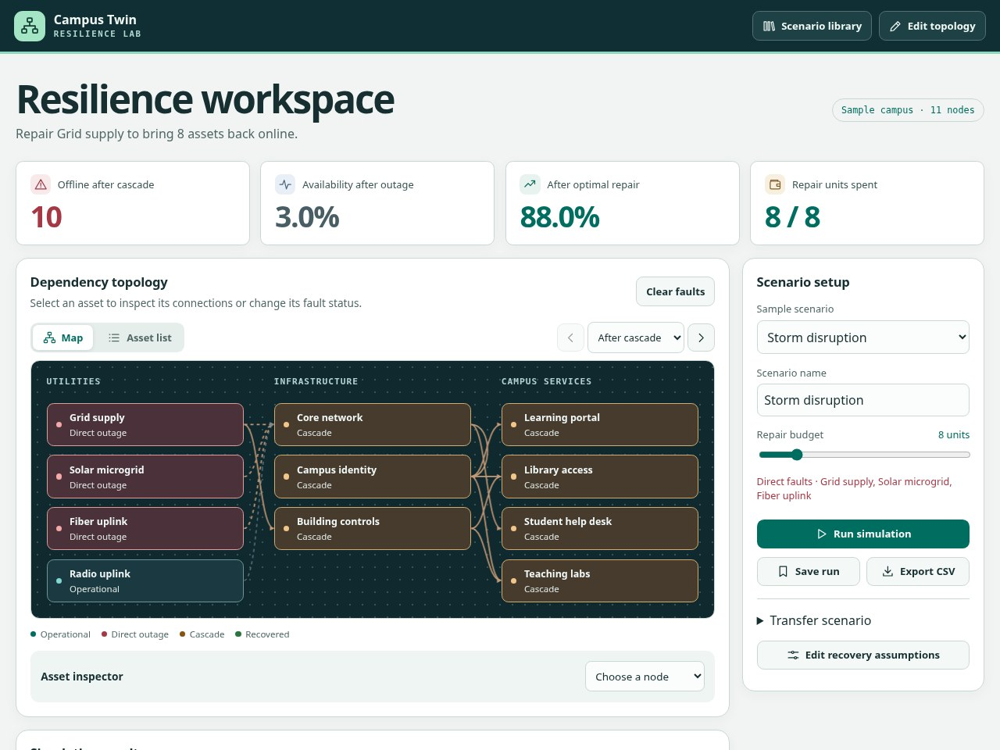

# Campus Twin · Resilience Lab

Campus Twin is a campus infrastructure what-if simulator. Model dependencies with redundant paths, inject direct outages, trace the resulting cascade and find the repair subset that restores the most weighted availability within a fixed budget.



## Run locally

Requires Python 3.11 or later. From the repository root:

```sh
python -m venv .venv
# macOS/Linux
source .venv/bin/activate
# Windows PowerShell instead: .venv\Scripts\Activate.ps1
python -m pip install -r requirements.txt
python app.py
```

Open http://127.0.0.1:8000. The sample Storm disruption runs on first load. No external API, account or sensor is needed. SQLite and its session signing key are created in `data/` on first run. Saved scenarios are scoped to the browser session cookie and survive application restarts with the same database and signing key.

## Try the demo

1. Open **Storm disruption**. With 8 repair units, the cascade drops weighted availability to 3%. The suggested grid repair restores it to 88%.
2. Change **Graph view** to **After recovery**, then save the run.
3. Change the budget to 4, name the run “Storm · budget 4”, run and save it. The best plan restores 53% under this cap.
4. Open **Scenario library**, select both runs and compare them. Close the dialog and export the current scenario as CSV.
5. Try **Uplink isolation**. Inspect **Radio uplink**, choose **Remove direct fault**, then run the simulation to see how a redundant path prevents the network cascade. Open **Edit topology** to change the redundancy rules.

Select any asset on the map or in the list to inspect its incoming connections and follow the services it directly supports. Choose **Mark as failed** or **Remove direct fault** to edit the scenario. The arrows beside the stage picker step through the recovery plan. The scenario library supports name search and keeps selected runs visible while you find a second run to compare.

## Recovery drill

Select **Recovery drill** and click the crew milestones. The graph shows the services that are available after each repair. Weighted availability reaches 53% at hour 2, 93% at hour 8 and 100% at hour 11. The service table shows when each deadline was met or missed. **Edit recovery assumptions** lets you change durations and deadlines and immediately rerun the scenario.

Under **Transfer scenario**, download a JSON file and open it in another browser to reproduce the calculation. CSV includes the crew schedule and deadline results. Previously saved runs retain their original results. Run them again to calculate a schedule using their available assumptions.

## Build and rehearse

Use **Edit topology → Asset builder** to add an asset, assign its priority and repair cost, and choose its upstream sources. Select alternatives within the same dependency group. Each additional group introduces another required condition. The JSON editor uses the same working copy. **Validate and apply** reruns the model and retains faults on surviving assets.

In **Recovery drill**, choose **Try a repair order** and move Grid supply earlier. **Compare orders** overlays both availability curves and reports deadline changes. This trial uses the same asset set, cost and crew hours as the recommendation. It lives in the rehearsal dialog. On small screens the workspace opens with **Asset list**, where every node has a text status and a list of requirements. **Map** restores the diagram.

## Project documentation

- [Project report](docs/REPORT.md) covers requirements, architecture, the algorithm, evaluation and scope.
- [Demo and acceptance guide](docs/DEMO.md) contains a presentation sequence and expected outcomes.
- [API and deployment guide](docs/API.md) describes input limits, endpoints and runtime configuration.

## Verification

```sh
python -m unittest discover -s tests -v
node --check static/app.js
```

To run the browser acceptance suite, start the app, install Node 22 and Chrome or Chromium, then run these commands in another terminal. Set `CHROME_BIN` to your browser executable.

```sh
npm ci --prefix tests/browser
CHROME_BIN=/usr/bin/chromium npm test --prefix tests/browser
```

The sample uses fictional assets and synthetic repair costs and priorities. This is a campus planning prototype using a manually authored logical model. The scores measure the model's weighted availability and have no associated real-world measurement or forecast.
