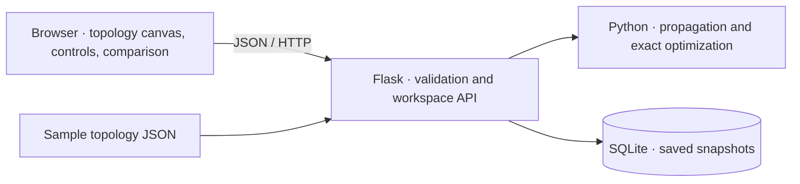

# Campus Twin project report

## Abstract

A university's network, utilities and digital services often share upstream resources. A disruption can therefore affect systems far removed from the original fault. Campus Twin models the dependencies explicitly, computes each step of a cascade, and recommends a repair portfolio under a constrained budget. Its contributions are a visual outage workbench, an explainable dependency model with redundancy and an exact optimization algorithm with an availability-versus-budget frontier.

## Motivation and related work

NIST describes infrastructure dependencies as a source of cascading failure and identifies scenario assessment and prioritization as applications for resilience planning. UC Berkeley's 2025–26 campus digital twin capstone illustrates the use of a unified campus model for infrastructure and energy management. UConn's Disaster Mitigation Lab treats cascade simulation and recovery optimization as related research directions. This project adapts those ideas to a browser-accessible teaching simulator with explicit decision rules and a repeatable demonstration.

- [NIST Community Resilience Planning Guide, Volume II](https://nvlpubs.nist.gov/nistpubs/SpecialPublications/NIST.SP.1190v2.pdf)
- [UC Berkeley Campus Digital Twin capstone](https://funginstitute.berkeley.edu/capstone-project/campus-digital-twin-for-infrastructure-and-energy-management/)
- [UConn Infrastructure Interdependency & Cascading Risk](https://dm2l.uconn.edu/research/infrastructure-interdependency/)

## Requirements

| ID | User need | Acceptance condition |
| --- | --- | --- |
| R1 | Build or load a campus model | Valid JSON edits apply. Unknown sources and dependency cycles are rejected. |
| R2 | Model direct and downstream outages | The graph distinguishes states and the timeline lists each wave with explainable dependency groups. |
| R3 | Allocate a scarce repair budget | The returned plan maximizes total operational weight within the specified budget. |
| R4 | Review alternatives | Two saved runs with the same topology can be compared by impact, budget and repair plan. |
| R5 | Share results | The export downloads scenario metrics and the status of each node as CSV. |
| R6 | Reproduce results | Saved runs retain topology, inputs and derived outputs, including after reload. |
| R7 | Keep separate workspaces | Switching browser sessions separates stored scenarios. Requests that mutate state require a session token. |
| R8 | Plan a single crew's recovery work | The schedule minimizes cumulative weighted outage for the selected portfolio and exposes intermediate graph states. |
| R9 | Evaluate recovery deadlines | Each configured deadline shows the actual restoration hour and its outcome. |
| R10 | Move a scenario across workspaces | Opening an exported input file recomputes the result in the receiving browser's session. |

## Architecture

The engine operates on validated topology, faults and budget. The HTTP layer owns request validation and persistence. The UI renders server results, with explicit invalidation when faults, model or budget change. The stored data entity is a run with an integer ID, browser workspace ID, name, UTC timestamp and serialized snapshot. The snapshot includes node definitions, faults, budget and result.

### Dependency and recovery rules

Each node has a positive priority weight, positive integer repair cost and zero or more groups of upstream prerequisites. A powered network switch might require either the grid or solar **and** either fiber or radio. Each group therefore represents alternatives, and every group must have an operational member. Cycles are rejected to preserve an unambiguous logical model.

Propagation starts with the direct faults. In each wave, all operational nodes with a fully offline dependency group join the outage set simultaneously. The set grows monotonically and converges after at most the number of nodes in the topology. The API records which group or groups became fully offline at each node's failure.

The optimizer enumerates all feasible subsets of directly failed assets. For each subset, it reruns propagation with the repaired assets removed from the direct fault set and sums operational weights. It chooses the greatest score, then the lowest repair cost, then the smallest repair count, then lexicographical asset IDs. Every feasible subset is considered, so the result is exact under the model's assumptions. The frontier records each spend level that strictly improves the best score over lower spend levels, up to the budget. For `N` nodes, `E` prerequisite references and `F` directly failed assets, the conservative upper bound is `O(2^F × (F + N × (N + E)))`. The 12-fault cap bounds the search to 4,096 subsets.

### Recovery sequencing and deadlines

The initial design represented only final availability. It could rank repair portfolios but could not tell a service owner how long users would lose access. NIST recommends specifying the desired time to recover each function and comparing it with anticipated performance. Campus Twin now allows an analyst to input deadlines and inspect restoration times under a single-crew assumption. [NIST Community Resilience Planning Guide, Volume I](https://nvlpubs.nist.gov/nistpubs/SpecialPublications/NIST.SP.1190v1.pdf)

For the chosen portfolio, let A(S) be the operational priority after repairing subset S and W the total priority. Starting with zero accumulated loss, the cost of appending job j equals its duration times (W − A(S)). For each subset, dynamic programming retains the lowest sum and breaks ties by lexicographical job order. This works because the available services after a subset depend only on which repairs have finished. The calculation reuses the portfolio search's scores. For k chosen jobs there are 2^k states and k × 2^(k−1) candidate transitions. Deadlines measure the resulting schedule. The optimization objective is weighted downtime over the repair horizon. Unresolved services continue to appear as offline after that horizon.

## Evaluation

The sample contains 11 synthetic nodes and 100 total priority points. The Storm disruption gives 3 points before repair, 53 points with the optimal 4-unit plan and 88 points with the optimal 8-unit plan. Its 8-unit plan repairs the grid and restores several downstream services. The test suite includes a separate case where two inexpensive repairs jointly unlock a service and outperform selecting the most valuable standalone repair. Additional tests cover redundancy, wave order, zero budget, cycle rejection, API validation and browser-workspace isolation. The sequencing tests also compare the dynamic program with every permutation of a five-repair case and verify deadline boundaries and missing timing data. A Chromium acceptance run also verified outage and recovery views, blocked-dependency inspection, saving, comparison, reload, CSV export, cycle validation and a 390-pixel viewport. The demo guide provides user-facing acceptance steps.

The 17-unit Recovery drill has three direct faults. Both orders below finish at hour 11 with all nodes available. The early recovery of the learning portal and student help desk accounts for part of the difference in cumulative loss.

| Repair order | First milestone | Lost priority-hours |
| --- | --- | ---: |
| Grid, solar, fiber | 88% available at hour 6 | 627 |
| Solar, grid, fiber | 53% available at hour 2 | 497 |

The optimal sequence saves 130 priority-hours (20.7%) relative to the specified grid-first order in this synthetic example. This metric integrates the unavailable priority from the initial outage through the last scheduled repair.

## Scope and limitations

The model assumes one crew, fixed costs, deterministic repair durations and successful, uninterrupted jobs. Downstream services recover immediately when their dependencies are satisfied. Site access, travel, shift changes, physical telemetry and multi-crew coordination are outside the simulation. The engine selects a portfolio for final availability first, then sequences that portfolio for minimum weighted downtime. The stated deadlines are evaluation criteria. All weights, durations and deadlines in the demo are synthetic. Workspaces use browser cookies. Portable files transfer the modeled inputs for use in another workspace.
